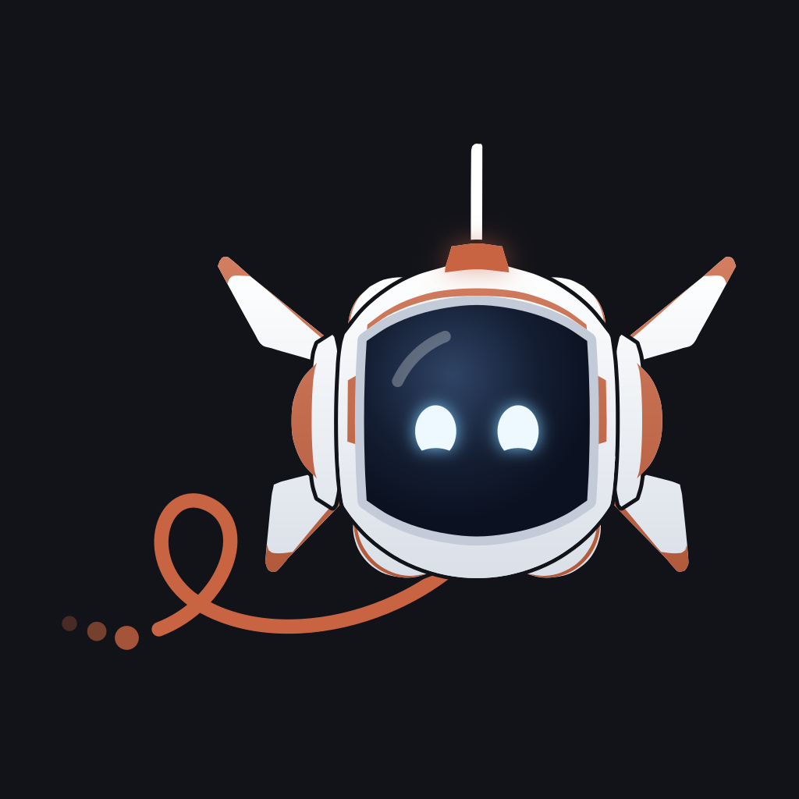
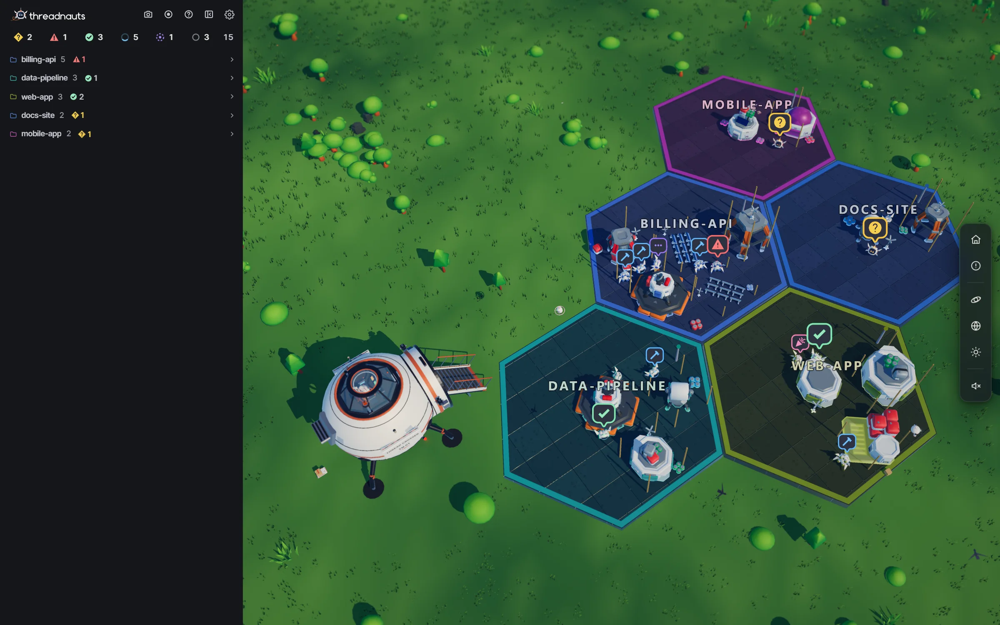
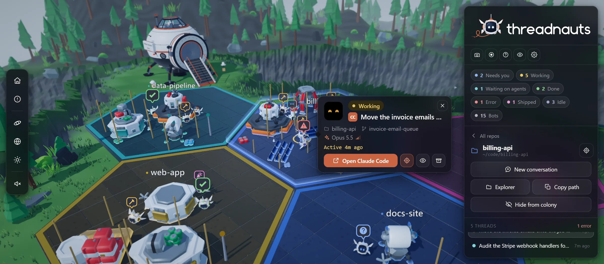
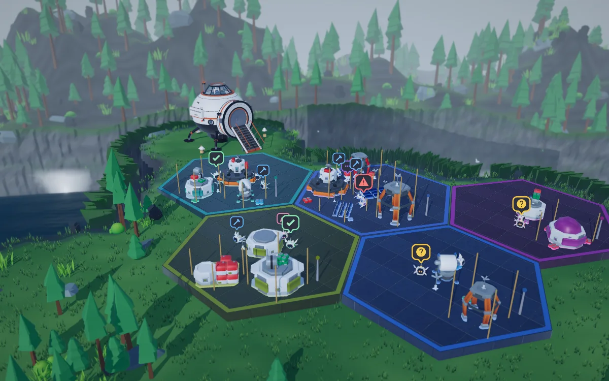
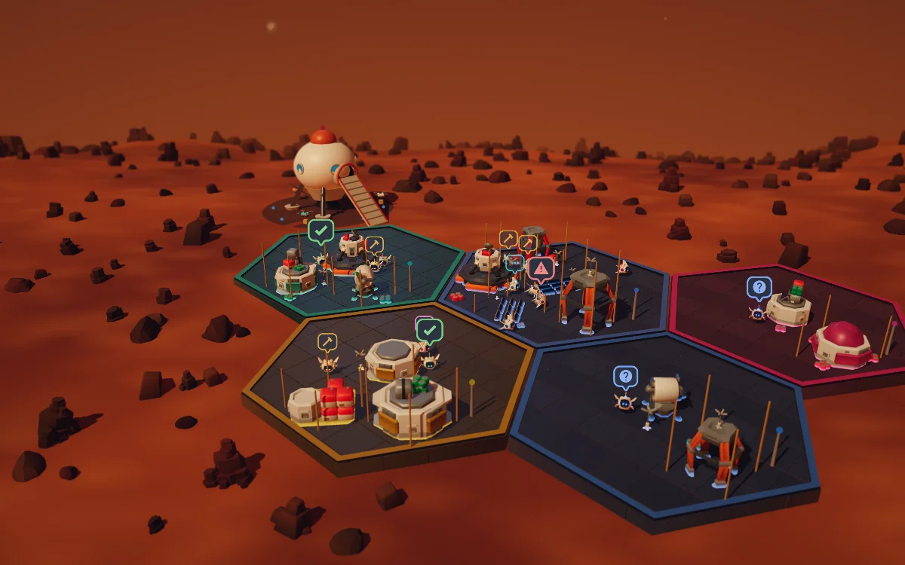
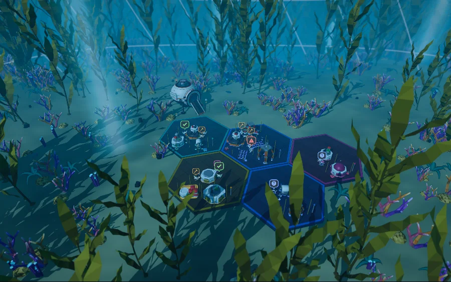
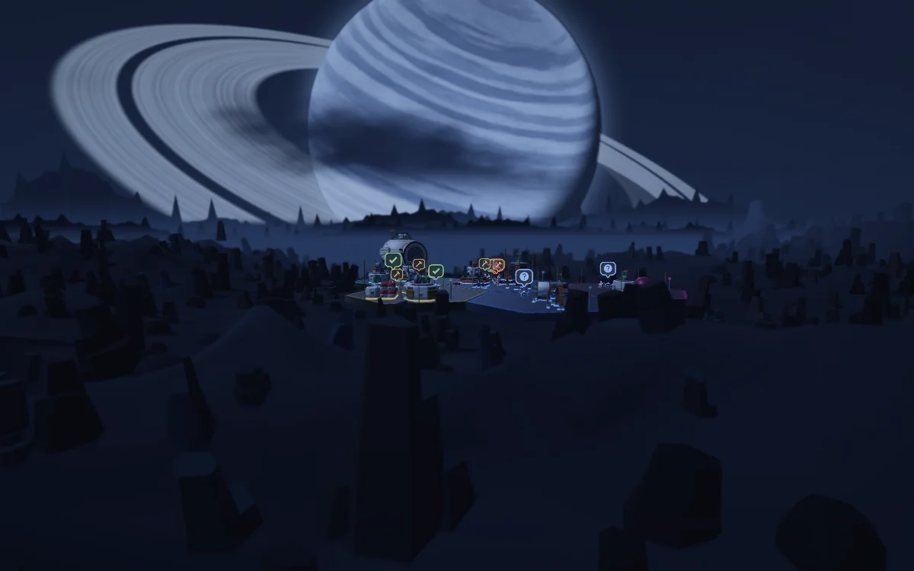
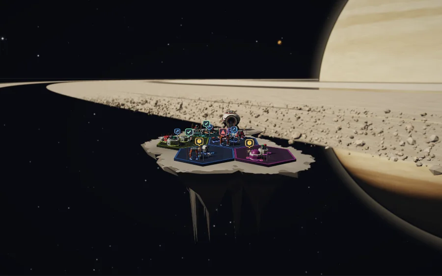
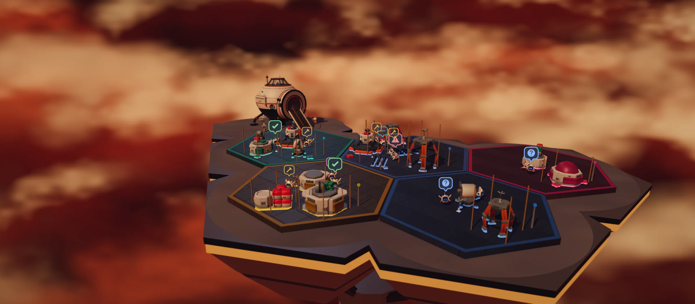

<p align="center">
  
</p>

<h1 align="center">Threadnauts</h1>

<p align="center">
  <strong>Every coding-agent thread on your computer, as a little bot in a 3D colony.</strong>
</p>

<p align="center">
  <a href="https://threadnauts.io">threadnauts.io</a> ·
  <a href="#get-started">Get started</a> ·
  <a href="docs/">Docs</a> ·
  <a href="https://github.com/threadcrumbs/threadnauts-community/issues/new/choose">Report a bug</a> ·
  <a href="https://github.com/threadcrumbs/threadnauts-community/discussions">Discussions</a>
</p>



Run a few agents at once and they get hard to keep track of. Threadnauts gives every repo a hex
zone and every thread a bot that builds there. When one needs you, it stops and holds a `?` over
its head. Click it, and the thread opens back in the harness it came from.

> **About this repo.** Threadnauts is free to use and closed source. This repo is where you
> report bugs, ask for features and harnesses, read the docs, and show off your colony. The app's
> source code isn't here.

## Get started

```bash
npx @threadcrumbs/threadnauts
```

You need [Node.js](https://nodejs.org) 22.13 or newer, on macOS, Windows, or Linux. The colony
opens in your browser at `http://127.0.0.1:5274`. Every harness you have installed shows up at
once.

## Works with

| Harness | |
| --- | --- |
| **[Claude Code](https://claude.com/claude-code)** | ✅ Desktop app and CLI, including worktrees |
| **[Codex](https://developers.openai.com/codex/cli)** | ✅ Desktop, VS Code, and CLI sessions |
| **[OpenCode](https://opencode.ai)** | ✅ Top-level sessions |
| **[Antigravity CLI](https://antigravity.google)** | ✅ Transcripts |
| **[Cursor](https://cursor.com)** | ✅ Agent transcripts |
| **[Hermes](https://github.com/NousResearch/hermes-agent)** | ✅ Sessions per profile |
| **[Kilo Code](https://kilocode.ai)** | ✅ Top-level sessions |
| Amp, Aider, Goose, Qwen Code, Amazon Q Developer CLI | Not yet. [Ask for yours](https://github.com/threadcrumbs/threadnauts-community/issues/new?template=harness.yml) |

What each one supports, and how its threads open, is in [docs/harnesses.md](docs/harnesses.md).

## What you're looking at

| In the colony | In your threads |
| --- | --- |
| One hex zone | One repo. Bigger repos claim more tiles |
| One bot and its building | One thread |
| A `?` over a bot's head | That thread is waiting on you |
| A bot with no building of its own | A subagent that thread has out right now |
| How finished a building looks | How long the thread's transcript is |
| A building with no bot | A thread you archived. What it built stays standing |

Click a bot to see its thread: what it's doing, its repo, branch, and model, and an **Open**
button that takes you straight back to it. Press `N` to fly to the next bot that's waiting on
you.



## It stays on your computer

- **It only reads.** Threadnauts reads each harness's own session files on your computer, and it
  never writes to a harness.
- **Nothing to sign up for.** There's no account, no sign-in, and no telemetry.
- **Your work stays put.** Your threads, code, and project names never leave your computer.
- **Pro sends one thing.** Threadnauts Pro sends its license key and a random ID for your
  computer, to activate and renew the license and to download Pro worlds.

The details are in [docs/privacy.md](docs/privacy.md).

## Eighty worlds

Every world has its own ground, scenery, and light from dawn to night. Twenty-four are free.
[Threadnauts Pro](https://threadnauts.io/pro) opens the other 56, and every world released while
you subscribe stays yours after you stop.

<table>
  <tr>
    <td></td>
    <td></td>
    <td></td>
  </tr>
  <tr>
    <td></td>
    <td></td>
    <td></td>
  </tr>
</table>

## Help and feedback

| | |
| --- | --- |
| Something's broken | [Report a bug](https://github.com/threadcrumbs/threadnauts-community/issues/new?template=bug.yml) |
| Your harness isn't supported | [Ask for a harness](https://github.com/threadcrumbs/threadnauts-community/issues/new?template=harness.yml) |
| You have an idea | [Suggest a feature](https://github.com/threadcrumbs/threadnauts-community/issues/new?template=feature.yml) or [a world](https://github.com/threadcrumbs/threadnauts-community/issues/new?template=world.yml) |
| You have a question | [Ask in Discussions](https://github.com/threadcrumbs/threadnauts-community/discussions/categories/q-a), or check [troubleshooting](docs/troubleshooting.md) |
| You like your colony | [Show it off](https://github.com/threadcrumbs/threadnauts-community/discussions/categories/show-and-tell) |
| You found a security problem | Don't file it publicly. See [SECURITY.md](SECURITY.md) |
| Anything else | [hello@threadcrumbs.io](mailto:hello@threadcrumbs.io) |

## Also from Threadcrumbs

**[Threadgauge](https://threadgauge.io)** is a live dashboard of the same threads: what each one
is doing, how full its context is, what it has cost, and how far through its plan it is. When
both are running, a bot's card shows its thread's context and opens it in Threadgauge.

## License

The docs, forms, and pictures in this repo are under [CC BY 4.0](LICENSE): share and adapt them,
with credit to Threadcrumbs LLC. Threadnauts itself isn't in this repo. It's free to use under its
own license, which ships with the app. The names Threadnauts, Threadgauge, and Threadcrumbs, their
logos, and Baut aren't licensed for reuse, except to refer to the apps.

## Credits

Threadnauts is made by [Threadcrumbs LLC](https://threadcrumbs.io). Threadnauts began as a fork of
[Bot Crossing](https://github.com/Station-Sciences/bot-crossing) by Jarren Rocks.

The 3D models are built from CC0 packs by [Kay Lousberg](https://kaylousberg.com),
[Kenney](https://kenney.nl), and [Quaternius](https://quaternius.com).

Not affiliated with Anthropic, OpenAI, Google, or any of the other harness vendors named here.
